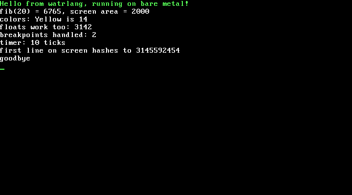

# watrlang

A compiled systems language with PHP-flavored syntax, written in plain C.
It's low-level enough to write an operating system in.

```php
struct Person {
    string name;
    int age;
}

function describe(Person p): string {
    return p->name . " is " . p->age;
}

function main(): int {
    Person ada = Person { name: "Ada", age: 36 };
    echo describe(ada), "\n";
    echo "Hello, {ada->name}! In ten years: {ada->age + 10}\n";
    return 0;
}
```

## Documentation

- [docs/LANGUAGE.md](docs/LANGUAGE.md): the language guide and reference,
  from hello world to generics, C interop and bare metal. Every example in
  it is compiled by `make test`.
- [docs/STDLIB.md](docs/STDLIB.md): every standard library function,
  generated from `std/` (`make docs` regenerates it).
- [docs/DESIGN.md](docs/DESIGN.md): design decisions and compiler internals.
- [skills/watrlang](skills/watrlang): a skill for LLM coding assistants
  (Claude Code, and anything else that reads `SKILL.md` folders). Copy the
  folder into `~/.claude/skills/` (or a project's `.claude/skills/`), or
  hand `SKILL.md` and its `references/` to any model that should write
  watrlang. It lists the rules that differ from PHP and C, a cheat sheet,
  and the full guide as references.

## Status

| Milestone | State |
|-----------|-------|
| 0. Skeleton (build, arena, diagnostics) | done |
| 1. Lexer | done |
| 2. Parser | done |
| 3. First binary: int math, calls, return | done |
| 4. Variables, if/while/for, parameters, globals | done |
| 5. Type system: sized ints, bool, floats, pointers, structs, arrays | done |
| 6. C interop: `extern`/`export`, libc, structs by value, `alloc`/`free` | done |
| 7. Strings, `echo`, interpolation; runtime written in watrlang | done |
| 8. Modules, `private`, a first standard library | done |
| 9. `defer`, enums, error unions (`T!E`, `?`, `??`) | done |
| 10. Classes: methods, constructors, `static`, `private`, `__toString` | done |
| 11. Garbage collector for objects and strings; `std/gc` | done |
| 12. `foreach`, PHP-style `array`, `mixed`, `std/arrays` | done |
| 13. `--freestanding`, inline asm with operands, `#[packed]`, `#[align]` | done |
| 14. A kernel in watrlang that boots in QEMU ([examples/kernel](examples/kernel)) | done |
| 15. Optimizer: an IR, linear-scan register allocation (`-O1`, the default) | done |
| 16. Inheritance: `extends`, interfaces, `abstract`, `protected`, `instanceof` | done |
| 17. Generics: `max<T>`, `Box<T>`, `Pair<A, B>`, inference for calls | done |
| 18. Standard library: `Vec<T>`, `Map<K, V>`, sort, fmt, fs, os, time, rand | done |
| 19. Optimizer, part 2: inlining, devirtualization, constant folding, bounds-check removal | done |
| 20+. More to come | planned |
| ∞. Self-hosting | someday |

## It runs on bare metal

[examples/kernel](examples/kernel) is a small x86-64 kernel written in
watrlang: VGA and serial output, an interrupt table, and timer interrupts,
built with `watrc --freestanding` and booted in QEMU.



## Error messages

watrc's errors follow Rust's style: an error code, the exact location,
labeled spans, notes, and suggested fixes.

```
error[E0200]: cannot find variable `countr` in this scope
 --> demo.watr:7:30
  |
6 |     int counter = 5;
  |         ------- a variable with a similar name is declared here
7 |     int total = compute_total(countr);
  |                               ^^^^^^ not found in this scope
  |
help: a variable with a similar name exists
  |
7 |     int total = compute_total(counter);
  |                               ~~~~~~~
```

Every code has a longer explanation with examples:
`watrc --explain E0200`. Warnings (`W0001` unused variable, `W0002`
unreachable code) don't stop compilation.

## Build

Needs a C99 compiler, `make`, and GNU binutils (`as`, `ld`) on x86-64 Linux.

```sh
make                          # builds build/watrc
make test                     # runs the test suite
make SAN=1 CC=gcc test        # same, with AddressSanitizer + UBSan
./build/watrc file.watr && ./file  # compile and run
./build/watrc -S file.watr         # just write file.s
./build/watrc --tokens file.watr   # dump tokens
./build/watrc --ast file.watr      # dump the syntax tree
```

## Tests

Each `tests/lexer/*.watr` (token dump), `tests/parser/*.watr` (syntax
tree) and `tests/run/*.watr` (compiled and run) has a `.expected` file
holding the output, error messages and exit code.

Two differential testers compile random code and check every result
against a Python model of watrlang:

- `tests/expr_fuzz.py`: expressions over every integer type, bool, f32,
  f64 and strings, with casts, concatenation and interpolation
- `tests/prog_fuzz.py`: whole programs with variables, if/else, loops,
  break/continue and calls with up to 8 arguments
- `tests/abi_fuzz.py`: random structs passed and returned by value
  between watrlang and gcc-compiled C, in both directions

`make test` runs a quick pass of each; for a long one add
`--seed 5 --programs 500`. After an intentional output change, regenerate
them with `UPDATE=1 ./tests/run_tests.sh` and review the diff.
